# Домашняя работа 3 - Cassandra

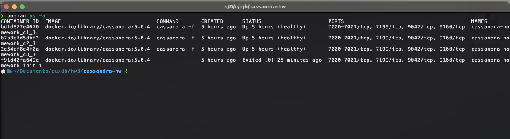

## 2. Таблица и модель данных

Партиция по `user_id` объединяет события одного пользователя. Это удобно для основного запроса, в котором мы хотим получить ленту его событий без просмотра данных остальных пользователей.

Обратный порядок кластеризации по `event_time` позволяет получать сначала новые события.

Если у двух событий одного пользователя совпадает `event_time`, их первичные ключи будут одинаковыми. Вторая вставка обновит существующую строку, поэтому часть истории может потеряться, что недопустимо для аудита. Чтобы сохранять оба события, можно добавить уникальный идентификатор события в первичный ключ.

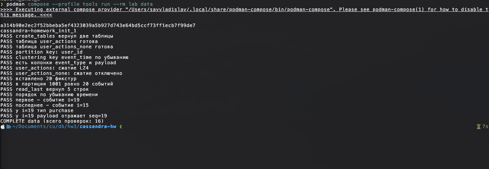

## 3. Вставка и чтение

Сценарий `data` прошёл 16 проверок: 20 контрольных событий вставлены, пять последних прочитаны в порядке убывания `event_time`.

| Что вставлено | Сколько | Время |
|---|---:|---:|
| События пользователя 1001 (`login`, `purchase`, `view`) в `user_actions` | 10 000 | 5,786 с |

Среднее время одной вставки: 5,786 / 10 000 = 0,0005786 с (0,5786 мс). Сценарий `bulk` прошёл все 5 проверок: в обеих таблицах по 10 000 событий, последние записи читаются в нужном порядке.

`PreparedStatement` позволяет подготовить запрос один раз, а затем многократно выполнять его с разными значениями через `bind`. Значения передаются отдельно от текста запроса, без сборки нового CQL-запроса для каждой записи.

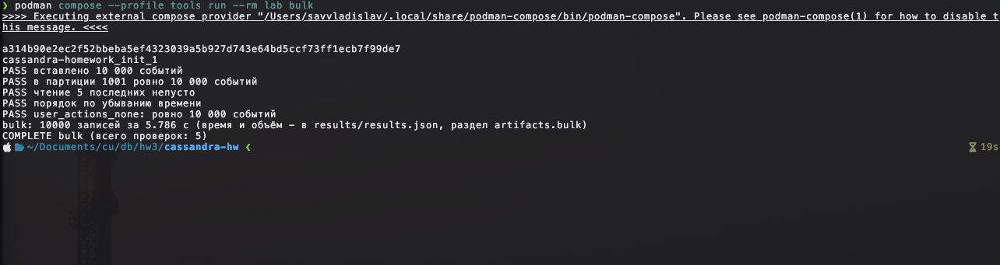

## 4. Консистентность

Замеры для записи 1000 событий и чтения 20 последних строк (медианы пяти прогонов):

| Уровень | Запись, мс | Чтение, мс |
|---|---:|---:|
| ONE | 576 | 2 |
| QUORUM | 863 | 2 |

При `ONE` достаточно ответа от одной реплики, а при `QUORUM` нужно дождаться двух из трёх. В этом прогоне запись с `ONE` оказалась быстрее; время чтения после округления одинаковое — 2 мс.

Условие `W + R > N` означает, что реплики, подтвердившие запись, и реплики, участвующие в чтении, пересекаются. Здесь `N = 3`. Если использовать `QUORUM` и для записи, и для чтения, получается `2 + 2 > 3`: хотя бы одна прочитанная реплика получила подтверждённую запись. Для `ONE` и `ONE` получается `1 + 1 ≤ 3`, поэтому пересечения может не быть и чтение может вернуть старое значение.

Для ленты событий я бы выбрал `QUORUM` на запись и чтение: для аудита важнее увидеть подтверждённое событие, даже если запрос займёт немного больше времени.

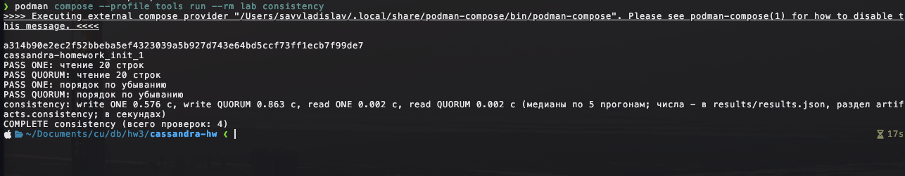

## 5. Сжатие

После `nodetool flush` сравнил таблицы по `tablestats` на узле `c1`:

| Таблица | Space used (total), байт | SSTable count | SSTable Compression Ratio |
|---|---:|---:|---:|
| `user_actions` (LZ4) | 34 173 | 1 | 0.38507 |
| `user_actions_none` (без сжатия) | 78 277 | 1 | -1.00000 (нет сжатия) |

С LZ4 таблица заняла меньше места. За это Cassandra тратит процессорное время на сжатие при записи SSTable и распаковку при чтении. Для журнала событий это полезно: данные постоянно накапливаются, а LZ4 сжимает их без большой нагрузки на процессор.

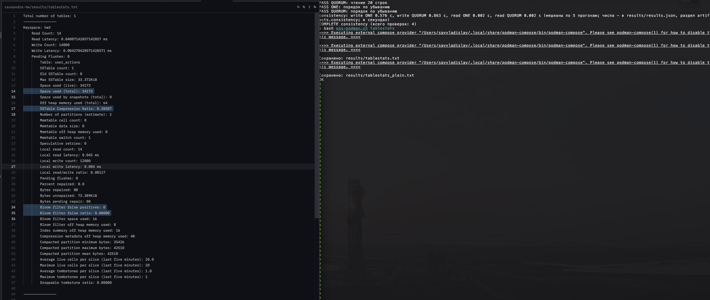

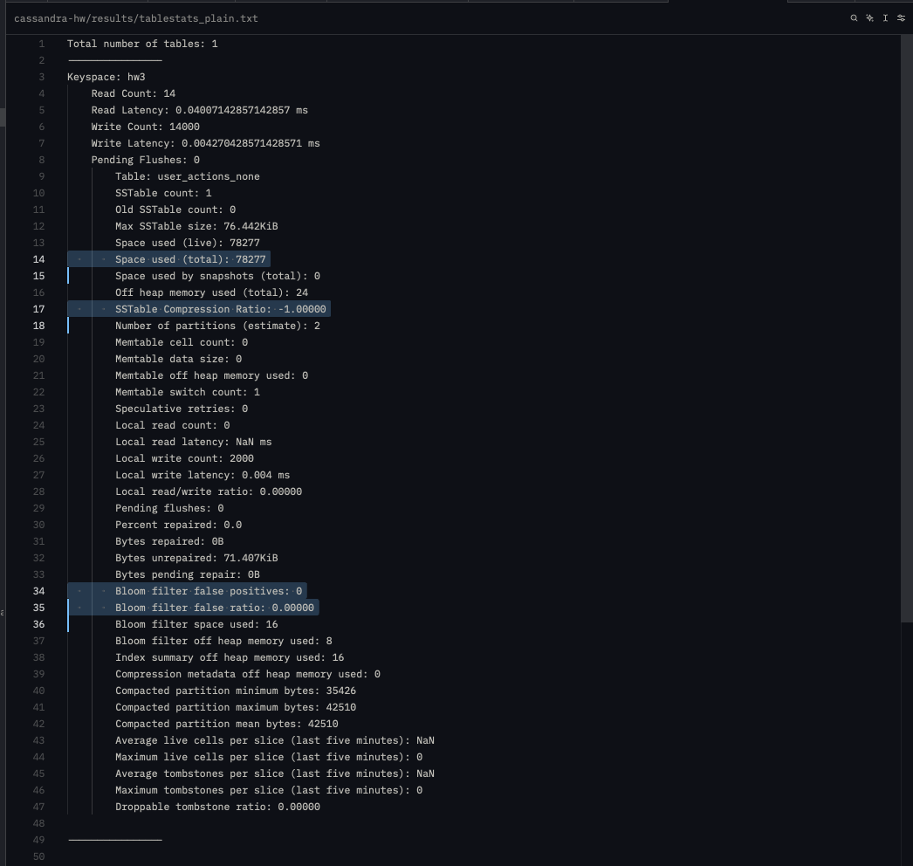

## 6. Bloom-фильтр

В `tablestats` для `user_actions` значения такие:

| Показатель | Значение |
|---|---:|
| Bloom filter false positives | 0 |
| Bloom filter false ratio | 0.00000 |

Bloom-фильтр помогает быстро понять, что ключа точно нет в SSTable, и тогда не нужно искать его в этом файле на диске. Иногда он ошибочно говорит «возможно, есть» - это и есть false positive. В моём замере таких ошибок не было. Фильтр особенно полезен при поиске отсутствующих ключей; если запрашивать в основном существующие, пользы от него меньше.

Значения Bloom-фильтра видны на [скриншоте tablestats](screens/05-06-compression-bloom.png).

## 7. Repair

Запустил `nodetool repair hw3`, результат сохранился в `results/repair.txt`. В файле есть строка `Repair completed successfully`.

Repair нужен, чтобы исправлять расхождения между репликами: он сравнивает их данные и синхронизирует различия вне обычного чтения. Это называется anti-entropy. Если реплика долго была недоступна и repair не запускать, она может остаться со старыми данными. Тогда чтение может вернуть устаревшее значение, а при пропущенном удалении после очистки tombstone старые данные могут появиться снова.

Read repair исправляет только данные, по которым произошло чтение. Hinted handoff сохраняет пропущенные записи для временно недоступной реплики и передаёт их после её возвращения. Оба механизма помогают, но не заменяют repair всех нужных диапазонов.

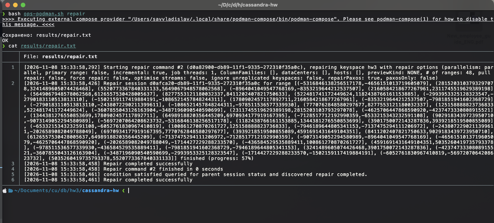

## 8. TTL и компакция

Для `user_actions` настроил TWCS с окном в один день и TTL по умолчанию 30 дней (`2592000` секунд). Сценарий `compaction` прошёл 5 проверок: до истечения тестового TTL в таблице было 5 строк, после - 0. При чтении с трассировкой увидел `Read 0 live rows and 10 tombstone cells`. После `nodetool compact` в `results/compaction.txt` появилась запись о major compaction таблицы `hw3.user_actions`.

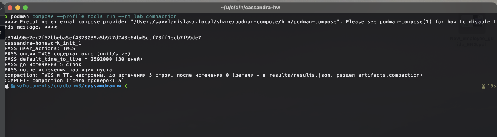

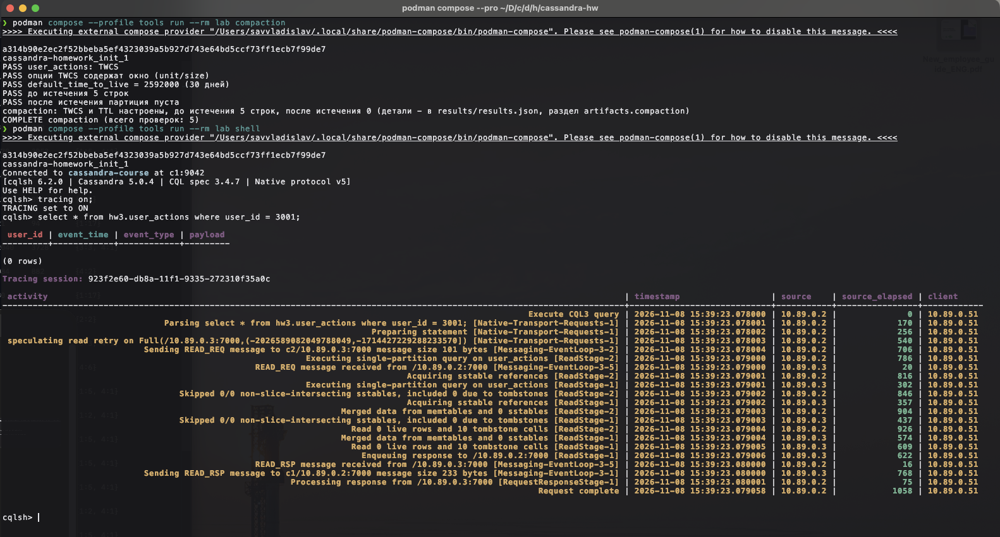

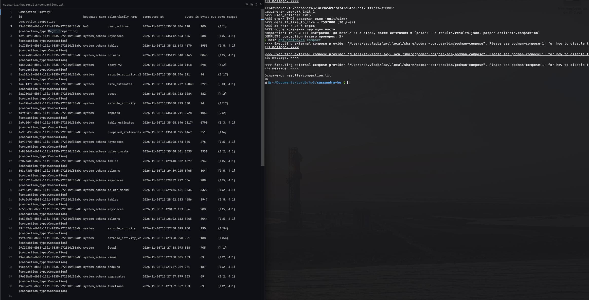

TWCS подходит для журнала событий: записи группируются в SSTable по временным окнам и старые файлы можно удалять, когда данные в них истекли. STCS группирует файлы по размеру и может смешивать старые записи с новыми, из-за чего освобождать место сложнее.

После истечения TTL строка перестаёт возвращаться при чтении, но отметка об удалении - tombstone - сохраняется до безопасной очистки. `gc_grace_seconds` даёт время передать удаление другим репликам, чтобы старые данные не появились снова. TTL удобнее массового `DELETE`: срок задаётся при записи, не нужен отдельный обход старых событий с множеством запросов на удаление. При этом TTL тоже создаёт tombstones.

## 9. Результаты

Исходники находятся в этой папке, результаты проверок — в `results/`, скриншоты — в `screens/`. Для повторения запуска:

```bash
podman compose up -d
podman compose --profile tools run --rm lab all
bash ops-podman.sh tablestats
bash ops-podman.sh repair
podman compose --profile tools run --rm lab compaction
bash ops-podman.sh compact
podman compose --profile tools run --rm lab metrics
```

Для трассировки после сценария `compaction` можно открыть `podman compose --profile tools run --rm lab shell` и выполнить `TRACING ON;`, затем `SELECT * FROM hw3.user_actions WHERE user_id = 3001;`.

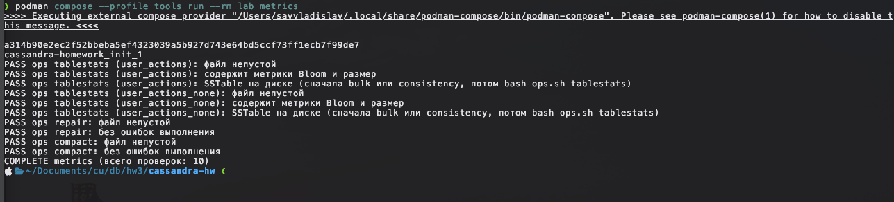
